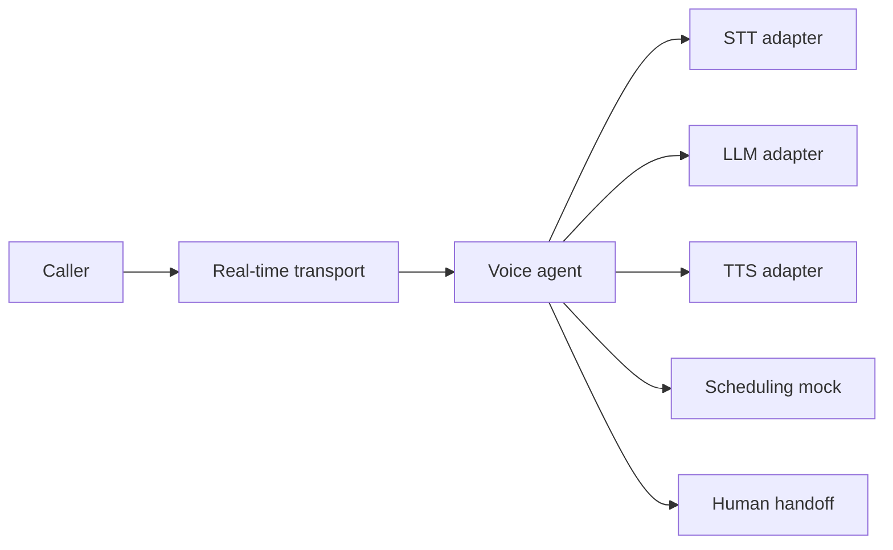

# Voice Agent Reference

Reference architecture for a real-time voice AI assistant. The fictional **Acme Health** assistant can check or reserve an appointment through a mock tool, while preserving an explicit human-handoff path.



## Quick start

```bash
cp .env.example .env
docker compose up --build
```

The default service exposes a local mock scheduling API at `http://localhost:8080`. Provider adapters are deliberately interfaces: configure an STT, TTS, LLM, and real-time transport only after assessing their terms, data processing, latency, and cost.

## Safety

- Do not send sensitive health information to an unapproved provider.
- Confirm caller intent before a booking action.
- Escalate urgent, ambiguous, or privacy-sensitive requests to a human.
- Keep recordings disabled by default and define retention before enabling them.

See [architecture](docs/architecture.md), [trade-offs](docs/latency-and-cost.md), [guardrails](docs/guardrails.md), and [observability](docs/observability.md).

MIT License © William Lima
